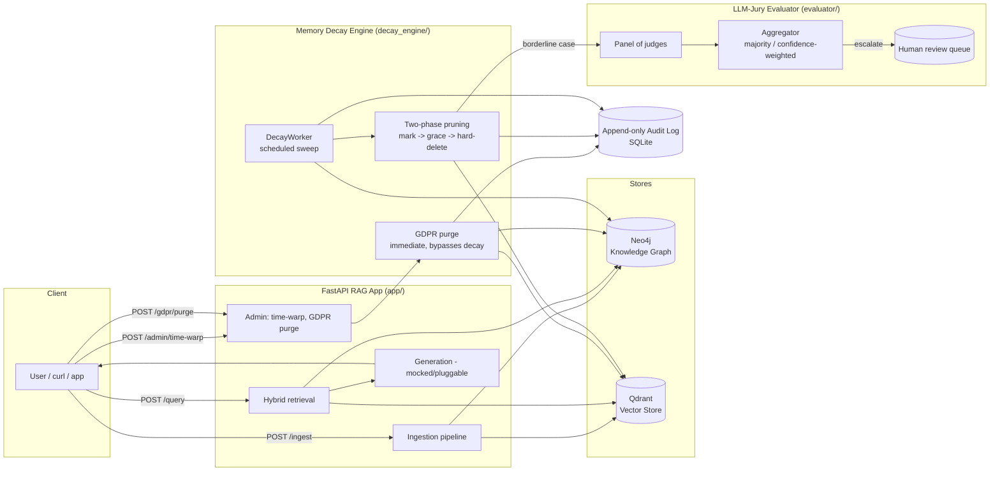
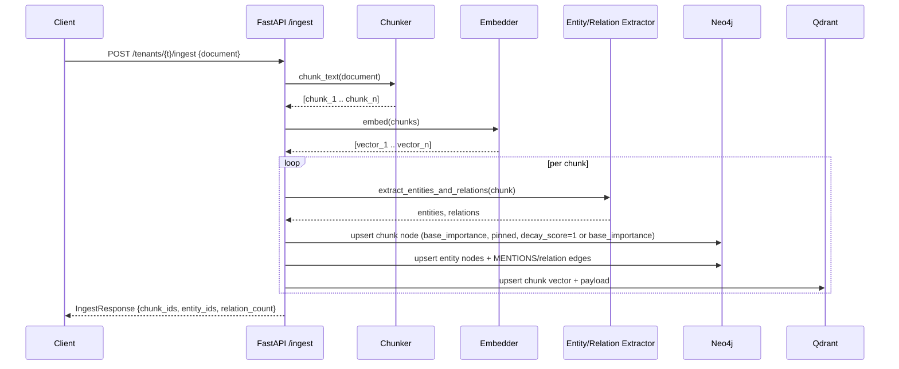
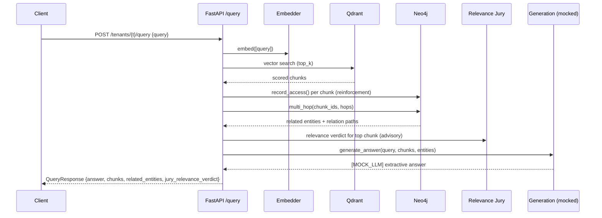
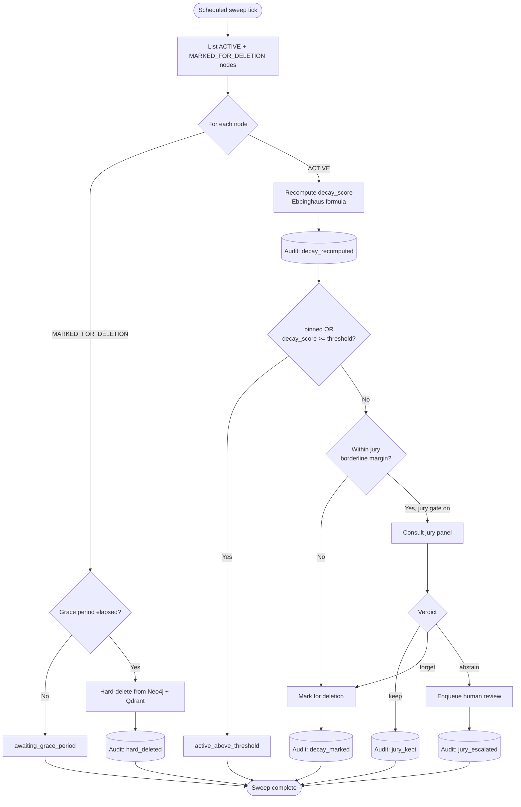
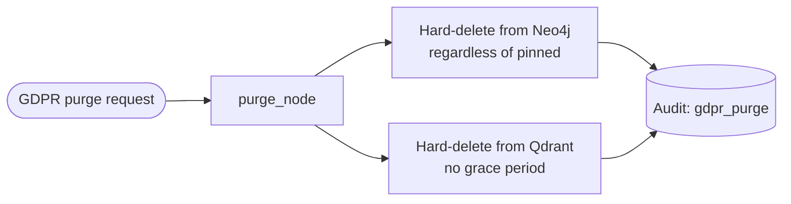

# GraphRAG Selective Forgetting

**Enterprise knowledge retrieval featuring neuro-inspired memory decay and active graph pruning.**

Most RAG systems only ever *grow*: every ingested document becomes
permanent weight on retrieval quality, storage cost, and - increasingly -
compliance risk. This project explores the opposite discipline: a
hybrid Neo4j + Qdrant knowledge base whose memories *age*, the same way
human memory does. A background **Memory Decay Engine** continuously
recomputes an Ebbinghaus-forgetting-curve-inspired `decay_score` for every
chunk/entity, reinforcing frequently-retrieved memories and actively
**pruning** stale ones in a safe, two-phase, audited way - while compliance
-critical facts can be `pinned` to opt out of decay entirely, and a
GDPR-style **right-to-be-forgotten** purge API handles explicit,
immediate erasure requests completely independently of the decay engine.
An **LLM-jury** (panel-of-judges) module adjudicates the borderline
"forget vs. keep" cases the decay engine isn't confident about, and
validates retrieval relevance quality.

This repository is a runnable, test-covered demo of that idea - not a
production system. See [Design decisions & honest limitations](#design-decisions--honest-limitations)
for exactly what's mocked.

---

## Table of contents

- [Architecture](#architecture)
- [Data flows](#data-flows)
- [Quickstart](#quickstart)
- [Demo script](#demo-script)
- [Design decisions & honest limitations](#design-decisions--honest-limitations)
- [The memory decay formula](#the-memory-decay-formula)
- [The LLM-Jury evaluator](#the-llm-jury-evaluator)
- [Multi-tenancy](#multi-tenancy)
- [Deployment](#deployment)
- [Testing](#testing)
- [Repository layout](#repository-layout)
- [License](#license)

---

## Architecture



## Data flows

### (a) Ingestion



### (b) Retrieval / query



### (c) Decay & prune lifecycle



Separately, and bypassing all of the above entirely:



---

## Quickstart

### Option A: zero dependencies (fake in-memory stores)

```bash
python -m venv .venv && source .venv/bin/activate   # or .venv\Scripts\activate on Windows
pip install -r requirements.txt
USE_FAKE_STORES=true uvicorn app.main:app --reload
```

### Option B: full stack via docker-compose

> **Docker was not available in the environment used to build this repo**
> (no `docker` CLI / Docker Desktop / WSL distro present), so `docker compose
> up` could not be executed or verified here. The compose file's YAML was
> validated (`python -c "import yaml; yaml.safe_load(...)"` - see CI), and
> every service definition follows the standard, well-trodden images for
> Neo4j 5 / Qdrant / Redis. If you have Docker locally this should work
> as-is; please open an issue if it doesn't.

```bash
docker compose up -d --build
curl http://localhost:8000/healthz
docker compose down
```

### Example calls

```bash
# Ingest a document
curl -X POST http://localhost:8000/tenants/acme/ingest \
  -H "Content-Type: application/json" \
  -d '{
    "document_id": "policy-2024-07",
    "text": "Acme Corp announced a new GDPR data retention policy. Jane Doe works at Acme Corp and leads compliance.",
    "base_importance": 0.7,
    "pinned": true
  }'

# Query (hybrid vector + graph retrieval)
curl -X POST http://localhost:8000/tenants/acme/query \
  -H "Content-Type: application/json" \
  -d '{"query": "What is Acme Corp'\''s data retention policy?"}'

# Inspect a node's decay bookkeeping
curl http://localhost:8000/tenants/acme/nodes/policy-2024-07::chunk::0

# Accelerate the virtual clock by 30 days to watch decay happen fast (demo only)
curl -X POST http://localhost:8000/admin/time-warp -H "Content-Type: application/json" -d '{"days": 30}'

# GDPR-style immediate right-to-be-forgotten purge (bypasses decay & pinning)
curl -X POST http://localhost:8000/tenants/acme/gdpr/purge \
  -H "Content-Type: application/json" \
  -d '{"node_id": "policy-2024-07::chunk::0", "requested_by": "data-subject-42"}'
```

The decay-engine worker (`python -m decay_engine.service`, or the
`decay-engine` docker-compose service) runs a sweep every
`DECAY_INTERVAL_SECONDS` (default 300s) against whichever tenants are
listed in `DECAY_TENANT_IDS`.

---

## Demo script

A suggested walkthrough for showcasing this repository end-to-end:

1. **Ingest a few documents** with varying `base_importance` and one
   `pinned: true` compliance document, via `/tenants/{t}/ingest`.
2. **Query immediately** - show relevant chunks, graph-connected entities,
   and the `jury_relevance_verdict` in the response.
3. **Time-warp forward** via `POST /admin/time-warp {"days": 20}` to
   simulate weeks passing without actually waiting.
4. **Trigger a decay sweep** (`python -c "from decay_engine.service import
   build_worker; w, t = build_worker(); print(w.run_once(t))"`, or wait for
   the worker's own interval) and inspect a node's `decay_score` dropping
   via `GET /tenants/{t}/nodes/{id}` - note the pinned document's score
   stays at `1.0`.
5. **Show an active pruning event**: a low-importance, never-re-queried
   chunk gets marked `MARKED_FOR_DELETION`, then (after another time-warp
   past the grace period + sweep) hard-deleted from both Neo4j and
   Qdrant. Pull the trail with the audit log (`AuditLog.list(...)` or a
   direct `sqlite3 data/audit_log.sqlite3 "select * from audit_log"`).
6. **Show retrieval quality before/after forgetting**: re-run the same
   query before and after the prune event and compare `chunks` returned.
7. **Show the jury flagging a borderline decision**: pick
   `prune_threshold`/`jury_borderline_margin` so a node lands in the
   borderline band; show the `audit_log` rows
   `jury_review_requested` -> `jury_escalated` (or `jury_kept` /
   `jury_confirmed_forget`), and, if escalated, the row appearing in the
   `human_review_queue` table.
8. **Show the GDPR purge path** acting immediately on a *pinned* node,
   contrasting it with the multi-step decay/prune flow above.

---

## Design decisions & honest limitations

What's **real** in this demo:
- The decay formula, two-phase pruning state machine, audit log, jury
  aggregation logic, tenancy naming conventions, and the full FastAPI
  request/response contracts.
- Real Neo4j (`neo4j` Bolt driver) and real Qdrant (`qdrant-client`)
  adapters are implemented and used by docker-compose.
- The hashing-based fallback embedder and regex-based fallback entity
  extractor are genuinely what runs when no ML libraries/models are
  available - not a lesser "mock mode", just a simpler mode.

What's **mocked / simplified** for a zero-dependency, zero-API-key local
demo, and what a production build would need instead:

| Area | This demo | Production |
|---|---|---|
| Generation | Deterministic extractive `[MOCK_LLM]` string (see `app/generation.py`) | Real LLM call (OpenAI/Azure OpenAI/local model), same function signature |
| Embeddings | `sentence-transformers` if installed, else a deterministic hashing embedder with **no semantic understanding** | A properly evaluated, production-grade embedding model/API |
| Entity/relation extraction | spaCy if installed, else a small regex heuristic (capitalized phrases + ~7 lexical relation patterns) | A real NER/RE pipeline or an LLM-based extractor |
| Jury judges | Deterministic rule-based stub judges (by design, for CI determinism) + an optional Ollama-backed example | A real multi-model panel (small local models via Ollama, or a mix of providers), tuned and evaluated on your data |
| Neo4j tenancy | Single database, `tenant_id` property partition (Community Edition compatible) | True database-per-tenant (Enterprise/AuraDB), see `app/tenancy.py` |
| Audit log | SQLite, single writer | Postgres (or similar) for multi-writer durability at scale |
| Docker validation | YAML-parsed only; **`docker compose up` was not run** (no Docker available in the build environment) | Verify in a real Docker environment before relying on it |
| Cloud IaC | Bicep/Terraform written but **never applied** to a live subscription/project | Review, cost, and apply yourselves; see `docs/AZURE_DEPLOYMENT.md` / `docs/GCP_DEPLOYMENT.md` |

---

## The memory decay formula

Implemented in [`decay_engine/formula.py`](decay_engine/formula.py):

```
decay_score = base_importance * exp(-time_since_last_access_hours / stability)
stability   = half_life_hours * (1 + min(access_count, cap) * reinforcement_factor)
pinned      -> decay_score is always 1.0 (hard override, exempt from decay)
```

This is a direct adaptation of the **Ebbinghaus forgetting curve**
(`R(t) = e^{-t/S}`, where `R` is retention and `S` is trace "stability"),
with `S` growing (capped) as a node is repeatedly retrieved -
operationalizing Ebbinghaus's observation that rehearsal/reinforcement
slows forgetting, much like spaced-repetition systems. `base_importance`
scales the curve's ceiling rather than its shape, so an intrinsically
important fact decays from a higher baseline than a trivial one even at
equal elapsed time and access count.

## The LLM-Jury evaluator

Implemented in [`evaluator/`](evaluator/) (`jury.py`, `judges.py`,
`schemas.py`, `human_review.py`) and designed to be reusable - the module
has no dependency on the rest of this repo beyond `pydantic` (and
optionally `httpx` for the Ollama example judge), so it is meant to be
copy-pasted into sibling projects as-is.

**Design, honestly stated:** a single "LLM-as-judge" call is sensitive to
that one model's particular biases and prompt sensitivity. Polling a
*panel* of independent judges and aggregating their votes - sometimes
called "panel of judges" / "jury of models" in the LLM-evaluation
literature - is a well-documented mitigation for that single-model
variance, and is cheaper/faster when panel members are small or local
models rather than one large proprietary call per decision. **No specific
accuracy numbers or product names are claimed here**; whether a given
panel composition actually reduces error on *your* data is something you
have to measure, not something this README asserts.

Each judge independently returns a structured verdict:

```python
class Verdict(BaseModel):
    judge_name: str
    verdict: str          # e.g. "keep" / "forget", or "relevant" / "irrelevant"
    confidence: float     # 0..1
    rationale: str
```

The `Jury` aggregates votes via **majority vote** or **confidence-weighted
average** (configurable), and **abstains** (escalating to
`evaluator.human_review.HumanReviewQueue`) when the top two options are
within `abstain_margin` of each other - i.e. when the panel meaningfully
disagrees rather than just splitting by noise.

Two concrete use sites in this repo:
1. **Decay-engine pruning gate** (`decay_engine/pruning.py`): when a
   node's `decay_score` is within `jury_borderline_margin` of
   `prune_threshold` and it isn't `pinned`, the jury is consulted before
   marking it for deletion.
2. **Retrieval relevance check** (`app/main.py`'s `/query` endpoint): a
   small relevance-focused jury (`evaluator.jury.build_relevance_jury`)
   scores the top retrieved chunk against the query, attached to the
   response as `jury_relevance_verdict` (advisory only - never blocks the
   answer).

## Multi-tenancy

Full multi-tenant *infrastructure* (per-tenant auth, quota, routing) is
intentionally out of scope for this repo - that is the focus of the
sibling **`telemetry-rca-agentic-runtime`** project. What is implemented
and documented here is the **naming convention** (`app/tenancy.py`) every
store adapter follows:

- **Neo4j**: one database per tenant (`tenant_<id>`) in production
  (Enterprise/AuraDB); this demo's Neo4j Community Edition instead
  partitions by a `tenant_id` node property + index, switching to true
  per-tenant databases automatically when `NEO4J_MULTI_DB_ENABLED=true`
  against a multi-db-capable server.
- **Qdrant**: one collection per tenant (`tenant_<id>_chunks`) - this is
  real, unconditional isolation even in the local demo, since Qdrant
  supports unlimited collections on a single instance.

## Deployment

- [`docs/AZURE_DEPLOYMENT.md`](docs/AZURE_DEPLOYMENT.md) + Bicep in
  [`deployment/azure/`](deployment/azure/): Container Apps, Key Vault,
  Log Analytics, Qdrant-on-Container-Apps, optional Cosmos DB (Gremlin)
  reference.
- [`docs/GCP_DEPLOYMENT.md`](docs/GCP_DEPLOYMENT.md) + Terraform in
  [`deployment/gcp/`](deployment/gcp/): Cloud Run, Secret Manager, Cloud
  Logging, Qdrant on GKE or Qdrant Cloud reference.

**Both are reference IaC only - neither has been applied to a live cloud
subscription/project.** See each doc's caveats section before using them.

## Testing

```bash
pip install -r requirements.txt
pytest -v
ruff check .
```

The full suite (decay formula, two-phase pruning incl. the jury gate,
jury aggregation, GDPR purge, ingestion helpers, FastAPI endpoints) runs
against the in-memory fake Neo4j/Qdrant adapters - **no Docker, network
access, or API keys are required**. CI (`.github/workflows/ci.yml`) runs
`ruff check .` and `pytest` on every push/PR against Python 3.11.

## Repository layout

```
app/              FastAPI ingestion + hybrid retrieval service
decay_engine/     Ebbinghaus decay formula, two-phase pruning, GDPR purge, audit log, worker/service
evaluator/        Reusable LLM-jury panel-of-judges module
tests/            pytest suite (zero external dependencies)
deployment/azure/ Bicep IaC (reference only, not applied)
deployment/gcp/   Terraform IaC (reference only, not applied)
docs/             Azure/GCP deployment guides
.github/workflows/ci.yml   Lint + test CI
docker-compose.yml          Full local stack (Neo4j, Qdrant, Redis, app, decay-engine)
```

## License

[MIT](LICENSE)
